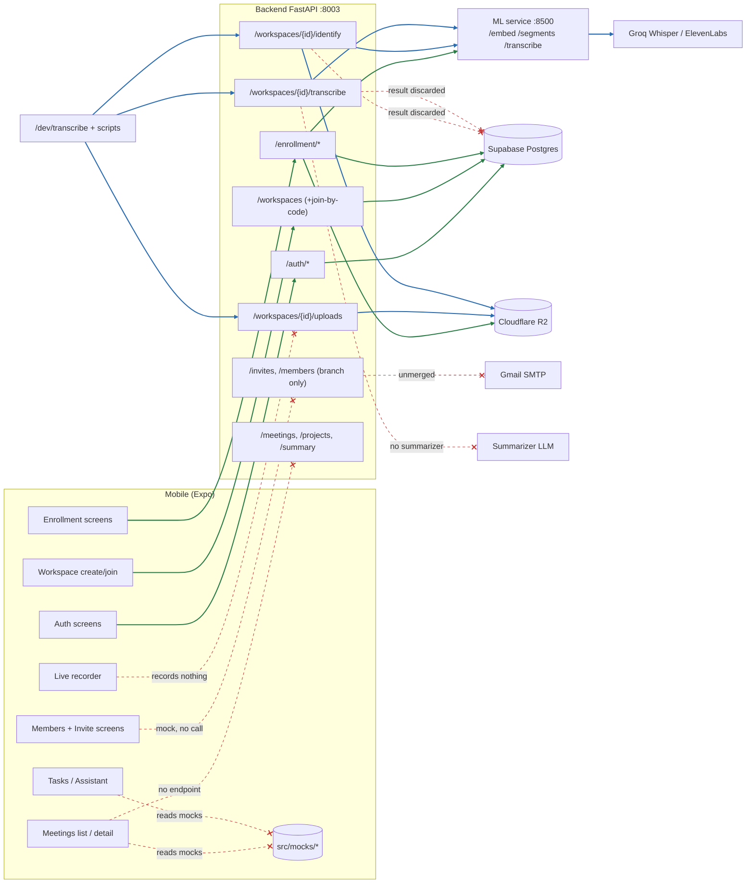

# Integration audit: does MeetAmongUs work as one flow?

Audited 2026-11-11 on `main` at `12e2746` (working tree had uncommitted edits to `CLAUDE.md` and `docs/HANDOFF.md` that predate this audit; neither was touched). Scope is the FYP-1 scope in the current `CLAUDE.md`: signup → workspace → enrollment → project → meeting → recorded audio → speaker ID → transcription → summarization.

## Verdict

**It is separate modules, not one flow.** Two chains work on their own and nothing joins them:

1. **Account chain (real, end to end):** signup/login → workspace create/join → voice enrollment. Mobile screens call real endpoints and data lands in Postgres and R2.
2. **Audio chain (real at the API, manual only):** upload a clip → `/identify` → `/transcribe`. It works, but the result is returned and thrown away. No screen calls it, nothing is saved, and it is driven only by `/dev/transcribe` or `scripts/identify_clip.py`.

Everything between those chains, and everything after them, is either mock data in the mobile app or does not exist: projects, meetings, consent, lobby, real recording, persisted transcripts, **summarization (see the note below)**, and the meeting result screen.

> **Note, summarization appeared mid-audit.** When I traced the code (01:3x) there was no summarization anywhere. While I was writing this report, uncommitted work for it appeared in `/ml` that I did not make: `ml/ml/summarizer.py`, `ml/tests/test_summarizer.py`, and edits to `ml/ml/config.py`, `ml/ml/service.py`, `ml/.env.example` (files stamped 01:42–01:44). It adds a `POST /summarize` endpoint on the ML service that takes numbered speaker turns and returns summary, key points, decisions and action items with turn citations, via Groq or Gemini. A little later the backend half appeared too: `backend/app/schemas/summary.py`, `backend/app/services/summary_service.py`, a `POST /workspaces/{id}/summarize` route in `workspaces.py`, and edits to `ml_client.py`, `exceptions.py`, `schemas/speaker_id.py` and `enrollment_service.py`. It accepts either a transcript or an `audio_key` and returns the summary. It cites ADR-0025 and ADR-0026, which are not in `docs/adr/` yet. **I did not run any of it, and the runtime check in section 3 ran before it existed.** Reading the new service, it has no `db.add` or commit, so like identify and transcribe it is **stateless: the summary is returned and not stored**, no screen calls it, and no `meetings` or summary table exists. Everywhere below that says "no summarizer", read it as "no summarizer is connected to a saved meeting or to the app; the one being written is uncommitted and unverified". The flow-table row for step 11 and work item 4 are updated to match; the breaks list and diagram still show it as absent. The Meetings tab, the live recorder, the meeting detail screen and the Tasks tab are polished UI over `mobile/src/mocks/`.

What I ran and what I only read:
- **Ran (section 3):** login → workspace → enrollment status → clip upload → `/identify` → `/transcribe`, against real Supabase, R2, the ML service and Groq.
- **Read, not run:** every mobile screen. I did not launch the app or an Android build in this audit. `docs/HANDOFF.md` says the redesign has never been tested on a device.
- **Not run:** the test suites. `backend/.env` has `TEST_DATABASE_URL` set and I could not confirm it is a separate database from the live one, so I did not risk it. Test counts below are counts of test functions, not pass results.

---

## 1. Flow table

✅ working · 🟡 partial or mock · ❌ missing. "Connected" means: does the output of this step reach the next step without a human or a script in between.

| # | Step | Mobile | API called | Backend | Downstream | Saved | Connected |
|---|---|---|---|---|---|---|---|
| 1 | Sign up / log in | ✅ `(auth)/login.tsx`, `signup.tsx`, Google button (native + web) | `POST /auth/signup`, `/auth/login`, `/auth/google`, `/auth/refresh`, `/auth/logout` | ✅ tested (`test_auth.py`, 16) | Postgres; Google token verification | `users`, `refresh_tokens` | ✅ (signup 201 and login 200 verified at runtime; Google not run) |
| 2 | Create / join workspace | ✅ `workspaces/create.tsx`, `join.tsx`, switcher | `POST /workspaces`, `GET /workspaces`, `POST /workspaces/join-by-code` | ✅ tested (`test_workspaces.py`, 10; `test_permissions.py`, 5) | Postgres | `workspaces`, `workspace_members` | ✅ (create 201, list 200 verified). Caveat: the Meetings tab then shows mock meetings, see break A1 |
| 3a | Invite members by email | 🟡 `workspaces/invite.tsx` runs, toast says "Invite sent to …" | **None.** `inviteMember()` in `api/workspaces.ts` returns `{ email }` | ❌ on `main`. Exists only on unmerged `origin/feature/workspace-invites` | Gmail SMTP (branch only; no SMTP settings on `main`) | Nothing. `invites` table exists but no code on `main` writes it | ❌ the success toast is false |
| 3b | Accept invite | ❌ no accept screen, no deep-link handler (`app.json` has scheme `mobile`, nothing consumes it) | None | ❌ on `main`. Branch has `POST /invites/preview` and `/invites/accept` | n/a | n/a | ❌ |
| 3c | Members list | 🟡 `workspaces/members.tsx` shows `mocks/members.ts` (fake people, fake "Not enrolled" badges) | None. `listMembers()` returns `orbitMembers` | ❌ on `main`. Branch adds `GET /workspaces/{id}/members` | Postgres | n/a | ❌ |
| 4 | Enroll voice | ✅ `enroll/index, permission, record/[language], review, result, done` | `GET /enrollment/status`, `POST /enrollment/uploads`, `PUT` to R2, `POST /enrollment/samples`, `DELETE /enrollment` | ✅ tested (`test_enrollment.py`, 9) | R2 presigned PUT; ML `/embed` | `enrollment_samples`, `voiceprints` (centroid), `users.enrollment_status`, R2 audio | ✅ in code (status call verified at runtime; sample upload not re-run; never run on a device) |
| 5 | Create project, add members | ❌ no screen. The project picker in `StartMeetingSheets.tsx` reads `mocks/projects.ts` | None | ❌ no model, migration, router or service | n/a | n/a | ❌ (postponed by `CLAUDE.md`) |
| 6 | Create meeting, invite members, add guests | ❌ "Start meeting" opens sheets then navigates to `live/new`. No create call. Guests are mock people | None | ❌ no `meetings` / `meeting_attendees` table or route | n/a | n/a | ❌ |
| 7 | Consent screen and lobby | 🟡 consent is a bottom sheet (checkbox gates the button), stores nothing. **No lobby screen.** "Join" takes a code and opens a hardcoded mock meeting | None | ❌ no `consent_records` | n/a | n/a | ❌ |
| 8 | Record on each phone, upload audio | 🟡 `live/[id].tsx` is a shell: running timer, fake level meter (`useMockLevel`), fake "Chunk N · N uploaded · 0 queued", fake "Synced ±12 ms". It records nothing | None from this screen | 🟡 a generic clip-upload URL exists, `POST /workspaces/{id}/uploads` (wav/flac/m4a/webm). No meeting, track or chunk rows, no checksum, no chunk ordering | R2 presigned PUT | R2 object only, referenced by nothing | ❌ |
| 9 | Identify speakers | ❌ no screen calls it | None | ✅ `POST /workspaces/{id}/identify`, tested (`test_speaker_id_service.py`, 18) | R2 get; ML `/segments`; `voiceprints` | **Nothing** | 🟡 API works (runtime 200). Manual only: `/dev/transcribe`, `scripts/identify_clip.py` |
| 10 | Transcribe | ❌ no screen calls it | None | ✅ `POST /workspaces/{id}/transcribe`, tested (`test_transcript_service.py`, 13) | R2 get; ML `/transcribe` → Groq (or ElevenLabs); runs identify again internally | **Nothing** | 🟡 API works (runtime 200). Manual only |
| 11 | Summarize: summary, decisions, action items | 🟡 shown on `meetings/[id]` from `mocks/transcript.ts` | None | 🟡 **In progress, uncommitted, not run:** ML `POST /summarize` and backend `POST /workspaces/{id}/summarize` (see note under the verdict). Stateless, there is no table, and `DATA_MODEL.md` lists `summaries`, `decisions`, `action_items` only as "later, not designed" | ML → Groq or Gemini (in progress) | Nothing | ❌ |
| 12 | View the meeting result in the app | 🟡 `meetings/[id]/index.tsx` is a finished screen on `mocks/meetings.ts` + `mocks/transcript.ts` | None | ❌ no `GET /meetings`, `GET /meetings/{id}`, no transcript store | n/a | n/a | ❌ |

---

## 2. Connection diagram

Solid green = real and used today. Solid blue = real endpoint, but only a script or `/dev/` page uses it. Dashed red = broken or missing link.

---

## 3. Runtime check

Services: ML on 8500 (`uv run uvicorn ml.service:app --port 8500 --env-file .env`), backend on 8003, both local, both against the real Supabase, R2 and Groq credentials in the repo's `.env` files. Test account created for the run (`audit-1794343171@example.com`). Audio was a **synthetic Windows text-to-speech clip** (10.8 s, 16 kHz mono WAV, an English sentence). No teammate's audio and no Meet captions were used.

| Call | Result |
|---|---|
| `POST /auth/signup` | ✅ 201, returns tokens and user |
| `POST /auth/login` | ✅ 200 |
| `GET /enrollment/status` | ✅ 200, `not_started`, three passages `not_attempted` |
| `POST /workspaces` | ✅ 201, `my_role=owner`, join code issued |
| `GET /workspaces` | ✅ 200, 1 workspace |
| `POST /workspaces/{id}/uploads` | ✅ 200, presigned URL + `audio_key` |
| `PUT` clip to R2 | ✅ 200 |
| `POST /workspaces/{id}/identify` | ✅ 200 in 29.6 s (first call after ML start, so includes cold-start) |
| `POST /workspaces/{id}/transcribe` | ✅ 200 in 14.8 s, engine `groq`, 10.765 s |
| `GET /meetings`, `/projects`, `/transcripts`, `/workspaces/{id}/members`, `/workspaces/{id}/invites`, `/workspaces/{id}/transcripts` | ❌ all 404. Nothing exists to read a result back |

**Where it breaks:** not inside the chain, but at its edges. Nothing before it produces a clip tied to a meeting, and nothing after it stores or shows the output. After `/transcribe` returned, the transcript existed only in my script's memory.

Things the run showed that the code reading would not have:
- **English comes back as Urdu script.** The transcript for the English sentence was phonetic Urdu letters. `ml_client.transcribe()` defaults `language="ur"` and the service passes no way to choose another (`backend/app/core/ml_client.py:114`). ADR-0023 makes the Urdu hint deliberate, so this is a trade-off, not a bug, but a meeting that is mostly English will read badly. The clip was TTS, so treat the exact text as indicative only.
- **Empty-voiceprint workspace gives "Unclear", not "Unknown Speaker 1".** My workspace had no enrolled members, so each segment stood alone (documented in `pool_into_runs`) and every one was under `min_group_seconds`. Expected, but it means the "Unknown Speaker N" grouping only exists once someone in the workspace is enrolled. I did not test a real multi-speaker, enrolled case.
- **Clips are never cleaned up.** `workspace-clips/{workspace_id}/{uuid}.wav` objects have no DB row and no expiry. I deleted the one I made.
- **`/transcribe` runs speaker identification again** (`transcript_service.transcribe` calls `identify_audio`), so a screen calling both would pay for identification twice.

Left behind by this run (the API has no delete for either): one user `audit-1794343171@example.com` and one workspace "Audit Probe Workspace" (`01a1c730-3e9f-70f0-adae-11ae4792e7dd`) in Supabase, plus their `refresh_tokens` rows. Remove them by hand if you want the DB clean.

**Shutdown:** both listeners (PIDs 24732 and 13972) and their `uv` parents were killed. A follow-up check found nothing listening on 8003, 8500, 8001, 8002 or 8081, and no `uv` or `uvicorn` processes running.

---

## 4. The breaks

### A. Screens running on mock data

| # | Screen | Mock source | Real endpoint it should use (does not exist yet unless noted) |
|---|---|---|---|
| A1 | Meetings list `mobile/src/app/(app)/meetings/index.tsx` (`listMeetings(workspaceIndex)`) | `mocks/meetings.ts`. Keyed by workspace **index**, not id: a new user's first workspace shows the "Orbit" mock meetings with people who are not in it | `GET /workspaces/{id}/meetings` |
| A2 | Meeting detail `meetings/[id]/index.tsx` | `mocks/meetings.ts`, `mocks/people.ts`, `mocks/transcript.ts` (segments, summary, decisions, action items) | `GET /meetings/{id}` |
| A3 | Rename Unknown Speaker `features/meetings/RenameSpeakerSheet.tsx` | `mocks/people.ts`. Rename only edits local React state (`setSegments`) | `PATCH` on a stored segment, needs persisted segments first |
| A4 | Live recorder `live/[id].tsx` | `mocks/meetings.ts`, `mocks/live.ts` (fake meter, fake participants), hardcoded 24:08 start, fake chunk counter, fake clock sync | `expo-audio` capture + chunk upload + a meetings API |
| A5 | Start meeting sheets `features/meetings/StartMeetingSheets.tsx` | `mocks/projects.ts` | `GET /workspaces/{id}/projects` |
| A6 | Members `workspaces/members.tsx` | `mocks/members.ts` via `listMembers()` in `api/workspaces.ts` | `GET /workspaces/{id}/members` (on the unmerged branch) |
| A7 | Invite `workspaces/invite.tsx` | `inviteMember()` returns `{ email }`; toast claims success | `POST /workspaces/{id}/invites` (branch) |
| A8 | Tasks `tasks/index.tsx` | `mocks/tasks.ts` | needs `action_items` (not designed) |
| A9 | Assistant `assistant/index.tsx` | `mocks/assistant.ts` | RAG is out of FYP-1 scope |

### B. Endpoints that exist but no screen calls
- `POST /workspaces/{id}/uploads`, `POST /workspaces/{id}/identify`, `POST /workspaces/{id}/transcribe`: only `backend/app/dev_static/transcribe.html` and `scripts/identify_clip.py` call them.
- `GET /workspaces/{id}`: no mobile caller (list is used instead).
- `GET /enrollment/passages`: mobile does not call it; it bakes the passages in at dev time via `npm run generate:passages` → `mobile/src/lib/enrollmentPassages.gen.ts`.
- On `origin/feature/workspace-invites` (not on `main`): `POST/GET /workspaces/{id}/invites`, `.../revoke`, `.../resend`, `POST /invites/preview`, `POST /invites/accept`, `GET /workspaces/{id}/members`. No mobile code calls any of them.

### C. Only work through `/dev/` pages or scripts
- Identify and transcribe: `/dev/transcribe` (`backend/app/routers/dev_transcribe.py`, gated by `DEV_TOOLS_ENABLED`) and `scripts/identify_clip.py`, which mints its own access token from the local `.env` and is not a login flow.
- Enrollment diagnostics, per-sample measurements and the admin user list: `/dev/enroll` only.
- Speaker-matching tuning: `scripts/segment_length_study.py`, `scripts/recompute_centroids.py`, `scripts/speaker_separation_test.py`. `docs/HANDOFF.md` records that the cross-language separation test has no results yet.
- `scripts/seed_demo.py` is referenced in `CLAUDE.md` but does not exist.

### D. Results returned but never saved
- `/identify` turns and `/transcribe` entries are computed and returned; no table or file holds them. `backend/app/models/` has no transcript, segment, summary, meeting or track model, and `alembic/versions/` has no migration for them (5 migrations: baseline, users, refresh_tokens, voiceprints+enrollment_samples, workspaces+invites).
- The uploaded clip in R2 is the only thing that persists, and it is referenced by nothing.
- Because nothing is saved, nothing can be viewed later, renamed, summarized, or searched.

### E. Output of one module does not match the next module's input
- **Transcript entry vs mobile segment.** Backend `TranscriptEntry` (`backend/app/schemas/transcript.py`): `speaker_label` (string), `user_id`, `start`, `end`, `text`, `language`. Mobile `MockSegment` (`mobile/src/mocks/transcript.ts`): `id`, `startSeconds`, `speaker` as a tagged union `{kind: member | guest | unknown, id, name | number}`, `language`. Gaps:
  - No segment `id` from the backend, so there is nothing to rename or cite.
  - "Unknown Speaker N" arrives only as a label string; the number would have to be parsed out of the text.
  - The backend has no `guest` kind at all (Guest vs Unknown is a core vocabulary rule in `CLAUDE.md`).
  - Backend can emit `"Unclear"` and `language: "unknown"`; mobile's `SegmentLanguage` is `"en" | "ur" | "mixed"` and has no "Unclear" speaker kind (`mobile/src/components/ui/TranscriptRow.tsx:16`).
  - Backend times are float seconds from clip start; mobile wants whole `startSeconds`.
- **Clip key vs meeting model.** Identify and transcribe take one `audio_key` under `workspace-clips/{workspace_id}/`. `DATA_MODEL.md` plans `meetings → recording_tracks → audio_chunks` with 30 s chunks per device. Nothing joins chunks into the single file the ML service accepts, and the endpoints take no meeting or track id.
- **Candidate set.** Identification compares against every voiceprint in the workspace (ADR-0020), not the meeting's attendees. Fine for a demo; it will mislabel as soon as workspaces grow.
- **Synchronous processing.** `/transcribe` does the whole job inside one HTTP request (900 s timeout in `ml_client.py`). The mobile `processing` and `failed` meeting states (`mocks/meetings.ts`) imply a background job that does not exist, and a 2-hour meeting cannot finish inside a request.
- **Audio format.** Mobile enrollment records with `RecordingPresets.HIGH_QUALITY` overrides (m4a on Android, webm on web, `mobile/src/lib/recording.ts`). `CLAUDE.md` locks WAV → FLAC for meetings. No code does that conversion.
- **Generated types.** `mobile/src/api/types.gen.ts` already includes identify/transcribe, but mobile code uses none of them. After the invites branch merges it must be regenerated (`npm run generate:types`).

### F. Hardcoded values that should come from config
- `mobile/src/config/env.ts:4`: fallback API URL is `http://localhost:8001`, a retired port (`HANDOFF.md`). It only works because `mobile/.env` sets 8003. A physical phone cannot reach `localhost` at all.
- `backend/app/main.py:17-18`: comment says the API is on 8001. Cosmetic.
- `mobile/src/app/(app)/live/[id].tsx`: after End, navigates to the hardcoded id `"meeting-hiring"`. `StartMeetingSheets.tsx`: Join always opens `"meeting-design-review"`; `new` is passed as the id for a new meeting.
- `backend/app/core/config.py`: `ml_service_url` defaults to `http://localhost:8500`, so the ML service must run on the same host as the API. There is no deployment story for it yet (ADR-0014 chose local-only).
- `allow_origins=["*"]` in `backend/app/main.py` (dev-only, flagged in a comment).
- Speaker-ID thresholds are provisional env-tunable defaults (`SpeakerIdSettings`); `voiceprints.match_threshold` 0.75 and the 15 s speech minimum are placeholders per `HANDOFF.md`.

### G. Steps that depend on something not built
- Summarization depends on persisted transcripts, which depend on persisted meetings and audio, none of which exist.
- The meeting result screen depends on a meetings API.
- Rename Unknown Speaker depends on persisted segments and `meeting_attendees` (guest rows).
- Multi-phone recording depends on the chirp beacon, track alignment and chunk upload. None are built, and the ML side processes one file only.
- Invite acceptance depends on merging the invites branch, deciding how the emailed link opens the app (`invite_link_base_url` is empty by default), and a mobile accept screen.
- **Merge hazard:** `origin/feature/workspace-invites` was cut before the speaker-ID merge. It adds `docs/adr/0020-invite-endpoints-and-token-handling.md`, but `main` already has `0020-speaker-matching.md`, so the ADR number collides. It also touches `GLOSSARY.md`, `workspaces.py` and `main.py`.
- The Android build (EAS APK) is postponed by `CLAUDE.md`. The redesign needs an EAS rebuild for `expo-haptics`, `expo-clipboard` and `expo-linear-gradient`, and nothing has run on a device.

---

## 5. What is needed to connect it

Ordered smallest-first within each group. **FYP-1** = needed to get from a recorded clip to a summary on screen. **Can wait** = real work, but not on that path.

| # | Piece of work | Size | Needed for |
|---|---|---|---|
| 1 | **Schema proposal** to `DATA_MODEL.md`, then migration: `meetings` with `project_id` nullable (the mobile sheet already says "saved without one"), `transcript_segments`, and a summary store (summary text plus decisions and action items, as JSON columns or tables). Per rule 6 this must be proposed and approved first | S | **FYP-1** |
| 2 | Meetings service + router: create meeting, register the uploaded `audio_key`, `GET` list, `GET` one. Reuse the existing clip-upload endpoint | M | **FYP-1** |
| 3 | A `process` step that runs identify + transcribe once (not twice) and **saves** the segments with ids, plus a `status` field (`processing` / `ready` / `failed`) | M | **FYP-1** |
| 4 | Summarizer. The ML half is already being written (`ml/ml/summarizer.py`, `POST /summarize`, uncommitted, unverified, ADR-0025/0026 not yet written). The backend route and service for it are also appearing (stateless). What is left is the storing: feed it saved segments rather than a pasted transcript, and persist the output with its turn citations. Review and run what is there before building on it | S (remaining) | **FYP-1** |
| 5 | Run `process` off the request path (FastAPI `BackgroundTasks` is enough; no queue). A short demo clip can run inline first | S | FYP-1 for anything over a few minutes |
| 6 | Mobile: real recording on the live screen: one file via `expo-audio`, upload through the existing presigned URL, call create + process. No chunks, no chirp | M | **FYP-1** |
| 7 | Mobile: replace `mocks/meetings.ts` and `mocks/transcript.ts` in the list and detail screens with TanStack Query hooks. Add the speaker-kind mapping (member / unknown / unclear) | M | **FYP-1** |
| 8 | Remove the fake meeting list for real workspaces (A1) so a new user does not see "Orbit" people | S | **FYP-1** (stops the demo lying) |
| 9 | Merge `origin/feature/workspace-invites` (renumber ADR 0020, regenerate types), then wire `members.tsx` and `invite.tsx` to it. Fix the false "Invite sent" toast either way | M | Can wait |
| 10 | Mobile accept-invite screen and deep link for the emailed token | M | Can wait |
| 11 | Persisted Unknown Speaker rename and guest attendees (`meeting_attendees`) | M | Can wait |
| 12 | Language choice for transcription (auto or per-meeting) so English-heavy meetings are not forced into Urdu script | S | Can wait, but worth a decision before demo content is chosen |
| 13 | Projects: tables, endpoints, picker screen, project members | L | Can wait (postponed in `CLAUDE.md`) |
| 14 | Consent records and meeting lobby | M | Can wait |
| 15 | Chunked 30 s upload, WAV → FLAC, 2 h cap, retry | L | Can wait (postponed in `CLAUDE.md`) |
| 16 | Chirp beacon, multi-device alignment, reference track | L | Can wait |
| 17 | Clip retention: delete or expire `workspace-clips/` objects | S | Can wait |
| 18 | Tasks screen on real `action_items`; Assistant / RAG | L | Later (RAG is out of FYP-1) |
| 19 | Housekeeping: `env.ts` fallback port, CORS, EAS rebuild and a real-device test | S–M | Before any phone demo |

---

## 6. Shortest path to an end-to-end FYP-1 demo

Goal: **record a clip in the app → see a summary in the app.** One phone, one speaker track, one workspace, no projects, no guests, no chirp, no chunking.

Flow that results:

1. Existing screens: sign up, create or join a workspace, enroll (already real).
2. **Start recording** on the live screen: a real `expo-audio` recording replaces the mock timer and meter. The consent sheet stays as is.
3. **End**: upload the file with the existing `POST /workspaces/{id}/uploads` + presigned PUT, then `POST` create-meeting with the `audio_key`.
4. Backend runs identify + transcribe once, saves segments, calls the summarizer, saves the summary, sets the meeting `ready`.
5. The meeting detail screen polls `GET /meetings/{id}` and shows the real transcript, summary, decisions and action items.

Minimum this requires, from the table above: items **1, 2, 3, 4, 6, 7, 8** (and 5 if clips run longer than a few minutes). That is one migration, one small meetings router and service, one summarizer, and swapping two mobile screens and the live recorder from mocks to queries.

Already in place and reusable as-is: auth, workspace, enrollment, presigned upload, the identification and transcription pipeline, the ML service, and the finished transcript/summary UI components.

Decide before building:
- **Demo language.** Under the current Urdu hint, English-heavy audio transcribes in Urdu script (section 3). Pick demo audio accordingly or take item 12 first.
- **Summarizer vendor.** The in-progress ML code supports Groq and Gemini. Groq reuses the existing key; Gemini adds a new secret and failure path. Its output carries turn citations, so the stored segments need stable ids and the summary store needs a place for the cited turn numbers. That feeds directly into the schema decision below.
- **Schema shape for decisions and action items** (JSON columns vs tables). This is the one decision that touches `DATA_MODEL.md` and needs your approval before any code.
- **Test the recorder on a real device early.** The redesign and the recorder are both unverified on Android, and that is where the demo will run.
